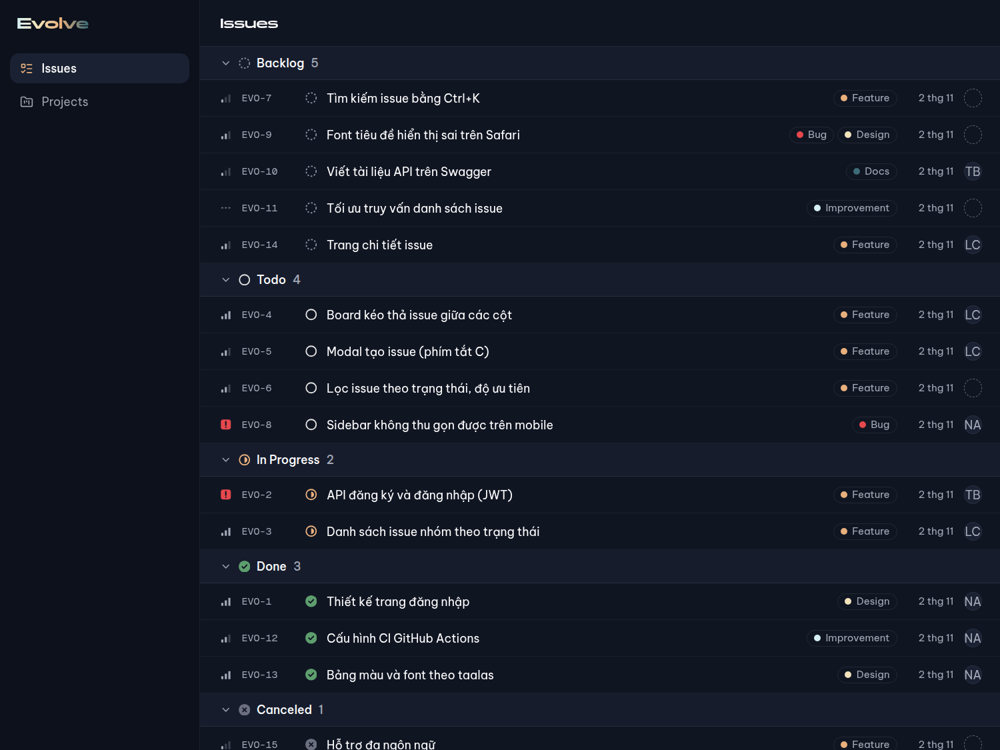
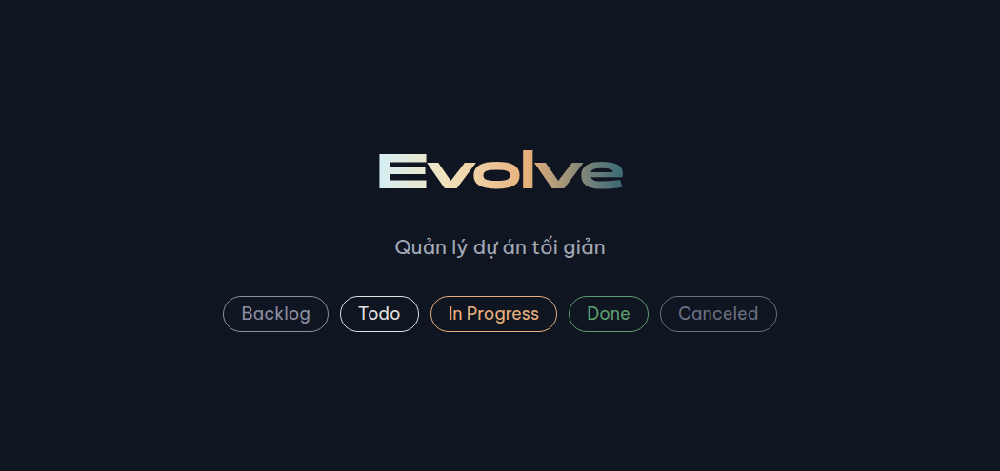
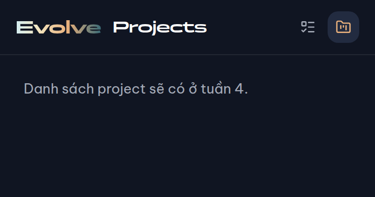
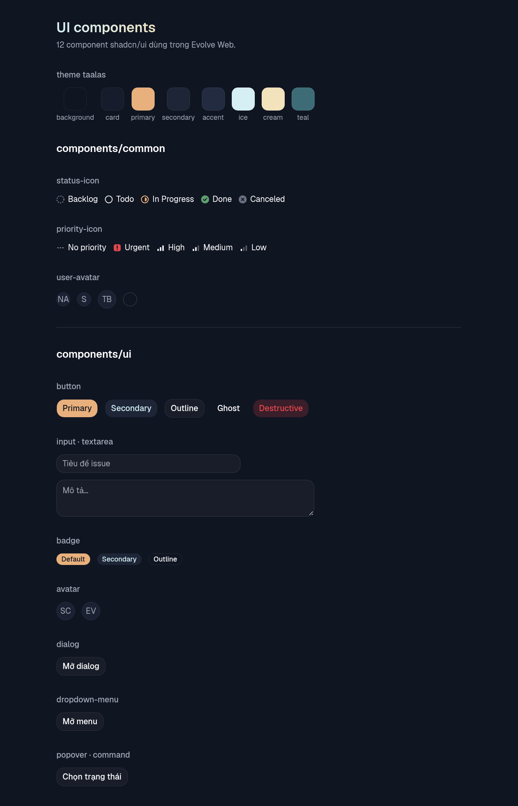

# Báo cáo tuần 2: Evolve Web

> Ngày lập: 08/11/2026 · Người lập: A (nhóm trưởng) · Mốc: **M2**
> Liên quan: [TIMELINE.md](../TIMELINE.md) · [ROLES.md](../ROLES.md) · [Báo cáo tuần 1](../W1/W1-A_TONG_KET.md)

## 1. Tóm tắt

| Hạng mục | Kết quả |
|---|---|
| Mốc M2 | ✅ **Đạt trên các branch** (chưa merge vào `dev`, xem mục 6) |
| Task | 11/11 task code xong (W2-B0, B1–B3, A1–A4, C1–C3); W2-ALL (họp, demo) chưa làm |
| Pull request | 12 PR (#36 → #47), **xếp chồng**, **chưa merge** |
| CI | GitHub Actions xanh trên #40 → #47 (#36–#39 tạo trước khi có CI, đã kiểm tra tay) |
| Test | shared 5/5 · api unit 4/4 + e2e 3/3 · web 10/10 |
| Người làm | Toàn bộ do **A** làm (kể cả task của B và C), commit đứng tên `dungpcaudio9999` |

**Mốc M2:** "Layout đúng theme taalas; trang `/issues` hiển thị list nhóm theo trạng thái với dữ liệu mẫu; database đã migrate và có dữ liệu seed" → cả 3 ý đều đạt.



## 2. Kết quả theo task

| Task | Người được giao | PR | Issue | Kết quả |
|---|---|---|---|---|
| W2-B0 | (A) | #36 | #28 | Contract: thêm `Project.key` (`EVO`) để sinh mã `EVO-12`; `key` không đổi được sau khi tạo |
| W2-B1 | B | #37 | #29 | Prisma 6 schema: User, Project, Issue, Label, IssueLabel; migration `init` (5 bảng) |
| W2-B2 | B | #38 | #30 | Seed: 3 users, 2 projects, 30 issues, 5 labels; `rank` bằng lexorank; chạy lại được |
| W2-B3 | B | #39 | #31 | `PrismaService`, bộ lọc lỗi thống nhất, `/health` báo `db: up/down` |
| W2-A1 | A | #40 | #24 | CI GitHub Actions: format, build, typecheck, lint, test, migrate trên PostgreSQL |
| W2-A2 | A | #41 | #25 | Theme taalas (nền `#101522`, nhấn `#E8B07C`…), class `text-gradient` |
| W2-A3 | A | #42 | #26 | Font Panchang (tiêu đề) + **Be Vietnam Pro** (nội dung) |
| W2-A4 | A | #43 | #27 | Layout `(main)`: sidebar, header, thanh điều hướng mobile |
| W2-C1 | C | #44 | #32 | Dữ liệu mẫu + store Zustand (thêm/sửa/xóa/đổi trạng thái/kéo thả) + Vitest |
| W2-C2 | C | #45 | #33 | `issue-line`, `label-badge`, định dạng ngày |
| W2-C3 | C | #46 | #34 | `issue-list` nhóm theo trạng thái, trang `/issues`, `/` → `/issues` |
| Báo cáo | A | #47 | – | File này |

## 3. Quyết định đã chốt (cần cả nhóm xác nhận ở buổi họp)

1. **`Project.key`** (2–5 ký tự hoa, ví dụ `EVO`) được thêm vào contract. DB lưu thêm `Project.issueCounter` và `Issue.number` để sinh `identifier = "<key>-<number>"`.
2. **`Issue` giữ `assigneeId`**, không nhúng thông tin người được giao. Web tự tra trong danh sách users.
3. **Prisma 6** thay vì 7: bản 7 bắt buộc `prisma.config.ts` và driver adapter, phức tạp hơn cho nhóm.
4. **bcryptjs** thay vì `bcrypt`: thuần JavaScript, không cần biên dịch native trên máy thành viên; mã băm tương thích bcrypt.
5. **Font nội dung là Be Vietnam Pro, không phải Poppins** như PLAN. Đã kiểm tra bảng ký tự:

   | Font | Thiếu chữ Việt |
   |---|---|
   | Panchang | `ƯẢầỄỆệỊỔỞỢỤỨ` |
   | Poppins | `ơƯưẢầỄỆệỊỔỞỢỤỨ` |
   | Be Vietnam Pro | không thiếu |

   → **Panchang chỉ dùng cho logo và tiêu đề tiếng Anh** (Issues, Projects); tiêu đề tiếng Việt dùng font nội dung.
6. **Giao diện chỉ có nền tối**, giống taalas.com.
7. **API vẫn khởi động khi DB chưa chạy**; `/health` trả `db: "down"` thay vì làm sập app. Nhờ vậy test và CI không cần DB (trừ bước migrate).
8. **Web có Vitest** để test logic store (TIMELINE không ghi, nhưng cần vì store sẽ đổi sang API ở W4).



## 4. Lỗi phát hiện và đã sửa trong tuần

| Lỗi | Nguyên nhân | Sửa ở |
|---|---|---|
| `start:prod` của API hỏng (không có `dist/main.js`) | `prisma/seed.ts` làm TypeScript đổi thư mục gốc, build ra `dist/src/main.js` | #39: loại `prisma/` khỏi `tsconfig.build.json` |
| Icon Urgent bị xám thay vì đỏ trong danh sách | className màu truyền vào đè mất màu đỏ | #45: Urgent luôn đỏ |
| Prisma không tải được engine khi `pnpm install` | pnpm 10 chặn script cài đặt của thư viện | #37: `onlyBuiltDependencies` trong `pnpm-workspace.yaml` |
| PR #40 lúc đầu thiếu file `ci.yml` | Lỗi thao tác khi tạo (xóa `.gitkeep` làm mất thư mục) | Commit bổ sung trong #40 |

## 5. Kiểm tra đã làm

| Kiểm tra | Kết quả |
|---|---|
| `pnpm install --frozen-lockfile && pnpm build && pnpm typecheck && pnpm lint && pnpm test && pnpm format:check` | Xanh ở từng PR (chạy trước khi tạo PR) |
| GitHub Actions | Xanh trên #40 → #47; bước migrate chạy trên PostgreSQL 16 thật |
| Migration + seed trên PostgreSQL 16 local | 5 bảng; 3 users, 2 projects, 30 issues, 5 labels; seed chạy 2 lần liên tiếp OK |
| Mật khẩu seed | `bcryptjs.compare('password123', hash)` = true, mật khẩu sai = false |
| `/health` | DB chạy → `db: up`; `docker stop` DB → `db: down` (app không sập); bật lại → `up` |
| Lỗi 404 | `{"statusCode":404,"message":"Cannot GET /abc","path":"/abc",…}` |
| Web | `/` → 307 `/issues`; `/issues` có 15 issue trong 5 nhóm; `/projects` 200 |
| Giao diện | Chụp màn hình desktop và mobile (ảnh trong `images/`) |

**Chưa kiểm tra tự động:** thu gọn/mở nhóm trong danh sách (web chưa có test component), cần kiểm tra bằng tay khi review.



## 6. ⚠️ Vì sao chưa merge và cách merge

Lần này **không merge bằng quyền admin** (bỏ qua review). Thay vào đó các PR được **xếp chồng**: mỗi PR có base là branch của PR trước, nên khi review mỗi PR chỉ thấy phần thay đổi của task đó.

```text
dev ← #36 B0 ← #37 B1 ← #38 B2 ← #39 B3 ← #40 A1 ← #41 A2 ← #42 A3 ← #43 A4 ← #44 C1 ← #45 C2 ← #46 C3 ← #47 báo cáo
```

**Lưu ý quan trọng (đã gặp ở tuần 1):** nếu merge một PR và xóa branch của nó **trước khi** đổi base của PR kế tiếp, GitHub sẽ **tự đóng** PR kế tiếp và không mở lại được. Vì vậy với mỗi PR, phải đổi base của PR sau sang `dev` **trước**, rồi mới merge.

Merge từng PR theo thứ tự (sau khi đã có người approve):
```bash
for n in $(seq 36 47); do
  next=$((n + 1))
  [ "$n" -lt 47 ] && gh pr edit "$next" --base dev   # đổi base PR sau trước
  gh pr merge "$n" --squash --delete-branch          # thêm --admin nếu chưa có ai approve
done
```

Sau khi merge xong:
- Đóng tay các issue #24–#34 và #28: `Closes #…` **không tự đóng** khi merge vào `dev` (chỉ tự đóng với branch mặc định `main`).
- Settings → Branches → `dev`, `main` → **Require status checks** → chọn `verify` (CI).

## 7. Việc còn lại / cần người thật làm

| Việc | Ai |
|---|---|
| **Mời B và C vào repo** (vẫn chỉ có 1 thành viên) | A |
| Review và approve 12 PR | B, C |
| Họp tuần 2, demo M2 (#35); xác nhận các quyết định ở mục 3 | Cả nhóm |
| B đọc lại `apps/api` (Prisma, seed, filter); C đọc lại `apps/web` (store, components) | B, C |
| Cài Docker Compose v2 trên mọi máy (`sudo apt install docker-compose-v2`) | Cả nhóm |
| Review contract tuần 1 (#8, #12) | B, C |

## 8. Chuẩn bị cho tuần 3 (Auth và tạo issue)

- **B:** module auth (register, login, JWT, `/auth/me`) trên nền `PrismaService` và bộ lọc lỗi đã có; tài khoản seed dùng để thử đăng nhập: `an@evolve.dev` / `password123`.
- **A:** trang `/login`, `/register` (layout riêng không có sidebar), `auth-store`, route guard.
- **C:** selector status/priority/assignee, modal tạo issue; gọi `useIssuesStore` (`addIssue`, `setStatus` đã có sẵn).
- Bản đồ store ↔ API: [docs/architecture/store-api-map.md](../architecture/store-api-map.md).

## Phụ lục: chạy lại kết quả tuần 2

```bash
git switch feature/W2-C3-issue-list          # hoặc dev sau khi đã merge
pnpm install
docker compose up -d                          # hoặc docker run như dưới nếu chỉ có docker-compose v1
cp apps/api/.env.example apps/api/.env
pnpm --filter api db:migrate
pnpm --filter api db:seed
pnpm dev                                      # web http://localhost:3000, api http://localhost:4000
```

Máy chỉ có `docker-compose` v1 (không chạy được với Docker Engine mới):
```bash
docker run -d --name evolve-postgres -e POSTGRES_USER=evolve -e POSTGRES_PASSWORD=evolve \
  -e POSTGRES_DB=evolve -p 5432:5432 -v evolve_postgres-data:/var/lib/postgresql/data postgres:16-alpine
```

Trang xem thử component: http://localhost:3000/dev/ui


