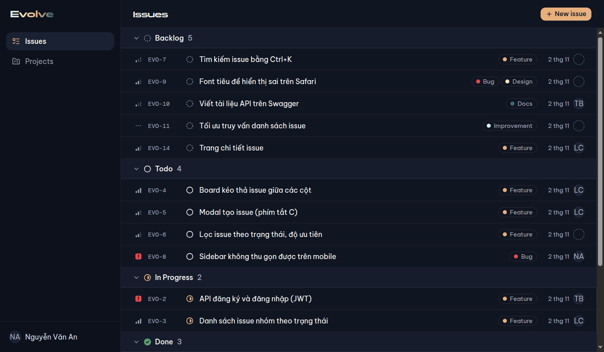
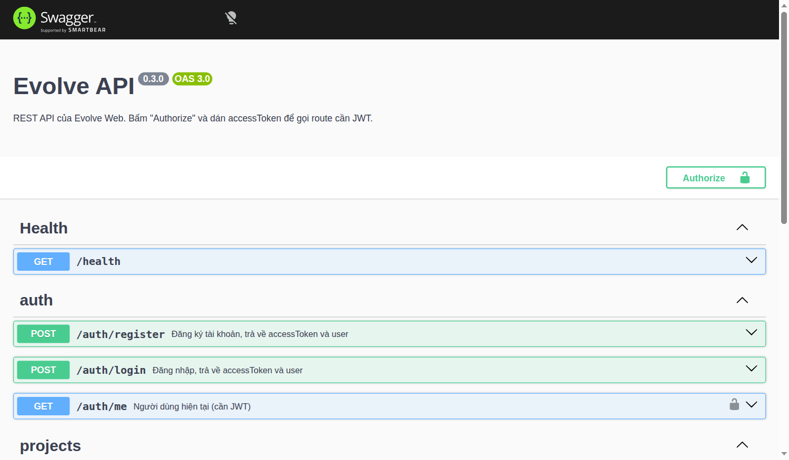
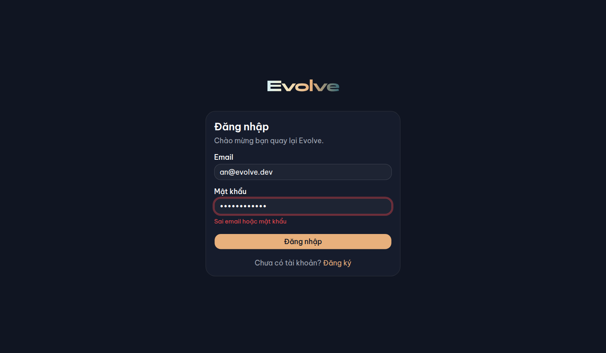
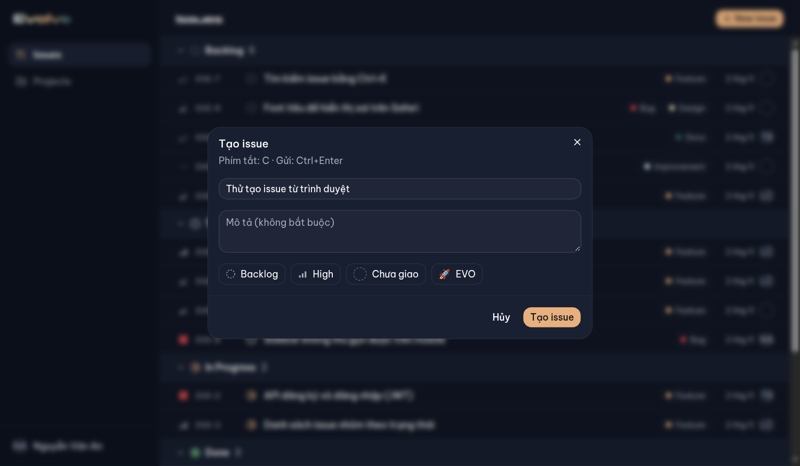
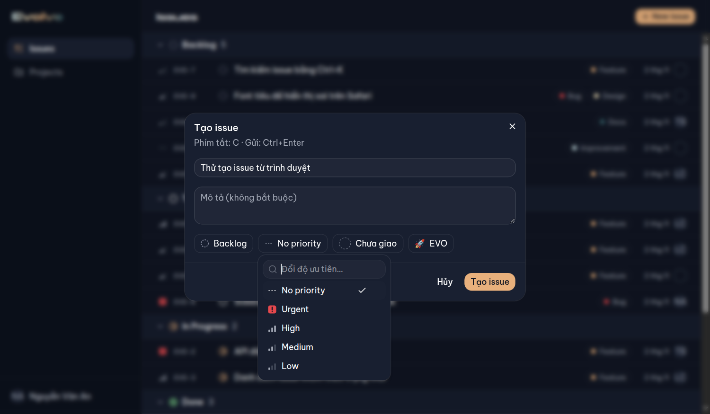
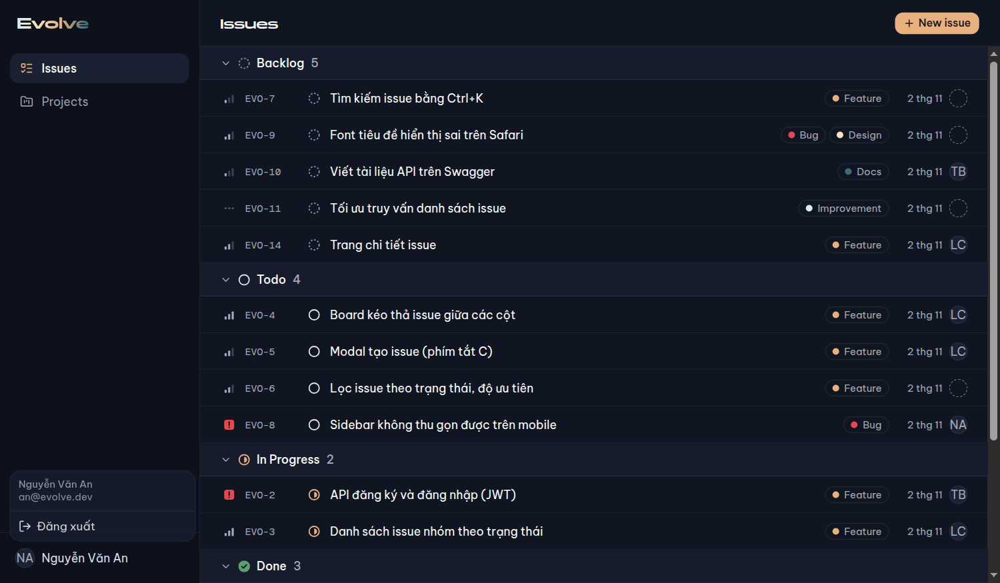
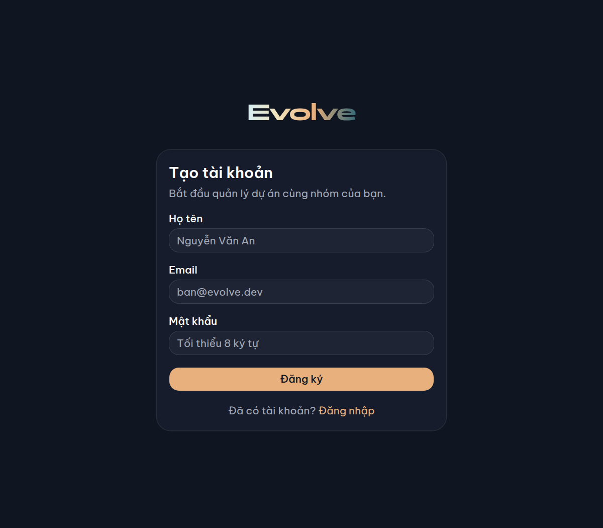
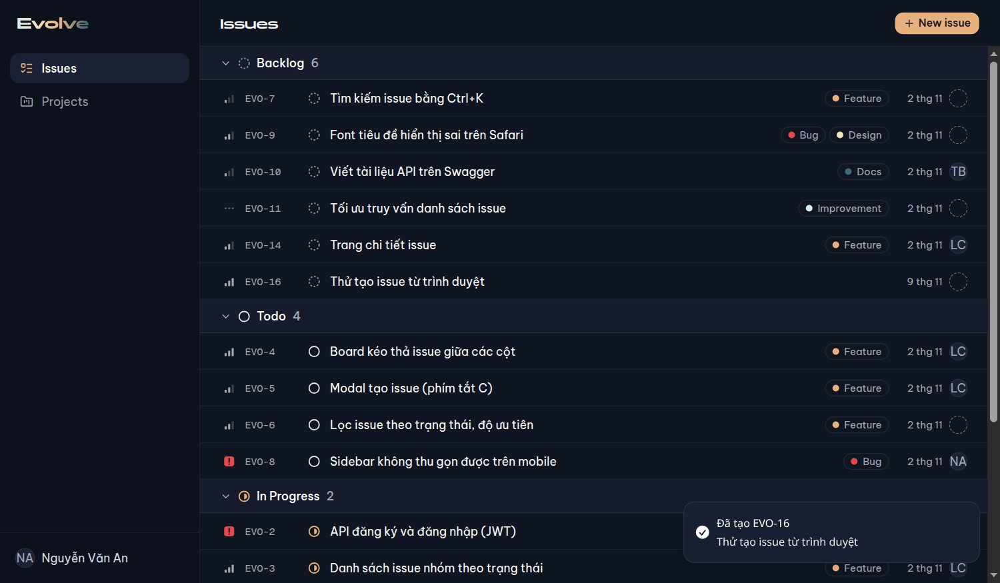

# Báo cáo tuần 3: Evolve Web

> Ngày lập: 09/11/2026 · Người lập: A (nhóm trưởng) · Mốc: **M3**
> Liên quan: [Hướng dẫn](HUONG_DAN.md) · [Nhật ký thực hiện](NHAT_KY.md) · [TIMELINE.md](../TIMELINE.md) · [Báo cáo tuần 2](../W2/README.md)

## 1. Tóm tắt

| Hạng mục | Kết quả |
|---|---|
| Mốc M3 | ✅ **Đạt, đã merge vào `dev`** |
| Task | 9/9 task code xong (W3-A1–A3, B1–B3, C1–C3); W3-ALL (họp, demo) chưa làm |
| Pull request | 9 PR (#58–#66), mỗi PR tách từ `dev`, **CI xanh rồi mới merge** (squash, quyền admin theo quyết định đã chốt) |
| Test | shared 5 · api unit 8 + e2e 19 · web 42 → **74 test**, tất cả xanh |
| Kiểm tra trên trình duyệt thật | 13/13 bước (Chrome headless, API + web + PostgreSQL) |
| Người làm | Toàn bộ do **A** làm (kể cả task của B và C), commit đứng tên `dungpcaudio9999` |

**Mốc M3:** "Đăng ký/đăng nhập trên web, nhận JWT, vào được trang Issues; chưa đăng nhập → `/login`. Trên giao diện tạo được issue, đổi được status/priority/assignee (chưa cần lưu DB)" → đạt cả hai ý.



## 2. Kết quả theo task

| Task | Người được giao | PR | Issue | Kết quả |
|---|---|---|---|---|
| W3-B3 | B | #58 | #48 | Swagger `/docs`; validation toàn cục bằng zod (`nestjs-zod`), lỗi trả theo từng trường |
| W3-B1 | B | #59 | #49 | `POST /auth/register`, `POST /auth/login`, `GET /auth/me`; JWT, bcryptjs |
| W3-C3 | C | #60 | #51 | `api-client` (gắn token, `ApiError`, toast, xử lý 401), lưu token |
| W3-A1 | A | #61 | #54 | Trang `/login`, `/register` (react-hook-form + schema của contract) |
| W3-B2 | B | #62 | #50 | `/projects` CRUD, chỉ chủ project thấy; seed: `MOB` thuộc Bình |
| W3-C1 | C | #63 | #52 | Selector status / priority / assignee, gắn vào dòng issue |
| W3-C2 | C | #64 | #53 | Modal tạo issue, phím tắt `C`, nút "New issue" |
| W3-A3 | A | #65 | #55 | Favicon thương hiệu |
| W3-A2 | A | #66 | #56 | `auth-store`, route guard, menu người dùng, đăng xuất |

## 3. Quyết định đã chốt (đã xác nhận với nhóm trưởng trước khi làm)

1. **Merge:** mỗi task một PR tách từ `dev`, CI xanh thì squash merge ngay bằng quyền admin. Không còn chuỗi PR xếp chồng như tuần 2 → **không có conflict, không phải force-push**.
2. **Quyền xem project:** chỉ chủ project. Người khác truy cập → **404** (không lộ project có tồn tại). Seed: `EVO` thuộc An, `MOB` thuộc Bình, Chi chưa có project.
3. **Token:** lưu trong `localStorage`, gửi bằng header `Authorization: Bearer`. Route guard chạy ở trình duyệt; API vẫn tự kiểm tra JWT ở mọi route cần đăng nhập.

## 4. Quyết định kỹ thuật phát sinh (cần cả nhóm biết)

| Vấn đề | Quyết định | Lý do |
|---|---|---|
| `@nestjs/swagger` ≥ 11.4.3 làm `nestjs-zod` 4 lỗi | **Ghim `@nestjs/swagger` 11.4.2** (exact) | Bản mới thêm `exports` chặn import sâu; `nestjs-zod` 5 đã sửa nhưng cần zod 4 (contract đang dùng zod 3). Ghi trong `apps/api/README.md` |
| `@nestjs/jwt`, `@nestjs/passport` bản 12 | Dùng **bản 11** | Bản 12 chỉ có ESM và dành cho NestJS 12; app đang là NestJS 11 (CommonJS) |
| Sai email và sai mật khẩu | **Cùng một thông báo** "Sai email hoặc mật khẩu" (401) | Không để lộ email nào đã đăng ký |
| `JWT_SECRET` | Bắt buộc khi `NODE_ENV=production`; dev thiếu thì dùng khóa tạm | Không chặn máy dev, nhưng không cho deploy thiếu bí mật |
| Chuyển hướng sau đăng nhập (`?next=`) | Chỉ chấp nhận đường dẫn nội bộ (`safeNextPath`) | Chặn chuyển hướng ra trang ngoài (open redirect) |
| Icon cạnh chữ cùng nghĩa | Thêm tùy chọn `decorative` (ẩn khỏi trình đọc màn hình) | Test phát hiện trình đọc màn hình đọc lặp "Backlog Backlog" |
| Tiêu đề tiếng Việt trong card | Thêm `font-sans` | `CardTitle` của shadcn mặc định dùng Panchang (không có chữ Việt có dấu) |
| Gói `cn` mà shadcn thêm vào | **Giữ lại** (plan dự kiến xóa) | 10 component shadcn `radix-nova` import trực tiếp từ gói này |
| Test component cho web | Thêm Testing Library + jsdom | Tuần 2 phần tương tác giao diện chưa có test tự động |



## 5. Lỗi phát hiện và đã sửa

| Lỗi | Phát hiện bằng | Sửa ở |
|---|---|---|
| Trình đọc màn hình đọc lặp tên trạng thái/độ ưu tiên ("Backlog Backlog") do icon có `<title>` riêng | Test component | #63: `decorative` cho icon và avatar |
| Tiêu đề "Đăng nhập" hiển thị bằng Panchang, chữ Việt bị lẫn font | Ảnh chụp màn hình | #61 |
| Rủi ro test chập chờn: e2e auth xóa mọi user `@evolve.test`, có thể xóa user của e2e projects khi chạy song song | Đọc lại code test | #62: mỗi bộ chỉ xóa user của mình, e2e chạy `--runInBand` |
| CI chạy migrate **sau** test → e2e trên CI không có bảng | Khi thêm e2e cần DB | #59: đưa bước migrate lên trước test |

## 6. Kiểm tra đã làm

**Tự động (chạy ở máy và trên CI cho mỗi PR):**

| Phần | Test | Nội dung chính |
|---|---|---|
| api unit | 8 | bộ lọc lỗi (gồm lỗi validate zod), `AuthService` (băm mật khẩu, 409, 401 cùng thông báo) |
| api e2e (PostgreSQL thật) | 19 | auth: đăng ký/đăng nhập/me, trùng email, sai dữ liệu, không token; projects: CRUD, người khác 404, key trùng 409, không đổi được key; `/docs-json` |
| web | 42 | store issue, api-client (mock fetch), auth-store, guard, trang đăng nhập, selector (mở/lọc/chọn bằng bàn phím), phím tắt C, modal tạo issue |
| shared | 5 | schema contract |

**Trên trình duyệt thật** (Chrome headless điều khiển qua DevTools Protocol, API + web + PostgreSQL chạy thật), 13/13:

| # | Kiểm tra | Kết quả |
|---|---|---|
| 1 | Chưa đăng nhập mở `/issues` → chuyển `/login?next=%2Fissues` | ✔ |
| 2 | Sai mật khẩu → "Sai email hoặc mật khẩu" dưới ô mật khẩu | ✔ |
| 3–5 | Đăng nhập `an@evolve.dev` → vào `/issues`, sidebar có tên, token đã lưu | ✔ |
| 6 | Tải lại trang → vẫn đăng nhập | ✔ |
| 7 | Đã đăng nhập mà vào `/login` → chuyển `/issues` | ✔ |
| 8 | Đăng xuất qua menu → về `/login`, token bị xóa | ✔ |
| 9 | Token giả → API 401 → bị đẩy về `/login`, token bị xóa | ✔ |
| 10 | Phím `C` mở modal tạo issue | ✔ |
| 11–12 | Tạo issue (đổi độ ưu tiên) → modal đóng, issue xuất hiện, toast "Đã tạo EVO-16" | ✔ |
| 13 | `/docs` hiện các route `/auth/*` và `/projects` | ✔ |

**Qua API (curl):** đăng nhập 3 tài khoản seed, `GET /projects`: An `['EVO']`, Bình `['MOB']`, Chi `[]`.

| Đăng nhập sai | Modal tạo issue | Selector |
|---|---|---|
|  |  |  |

| Menu người dùng | Trang đăng ký | Sau khi tạo issue |
|---|---|---|
|  |  |  |

## 7. Giới hạn hiện tại (đúng phạm vi tuần 3)

- **Danh sách issue vẫn là dữ liệu mẫu** trong trình duyệt: tạo/sửa issue chưa lưu vào DB, tải lại trang là mất. Nối API issue là việc của tuần 4 (W4-B1 API issues, W4-C1 store gọi API).
- Mọi người đăng nhập đều thấy cùng một bộ dữ liệu mẫu (project `EVO`), chưa lọc theo người dùng. Sẽ đúng khi nối API ở W4.
- Script kiểm tra trên trình duyệt (DevTools Protocol) chỉ dùng để kiểm tra lần này, **chưa đưa vào repo**. Test E2E chính thức bằng Playwright theo kế hoạch ở W6.

## 8. Việc còn lại / cần người thật làm

| Việc | Ai |
|---|---|
| **Mời B và C vào repo** (vẫn chỉ có 1 thành viên) | A |
| B, C đọc lại code đã làm thay (api: auth, projects, swagger; web: api-client, selector, modal) | B, C |
| Họp tuần 3, demo M3 (#57); các issue tồn đọng: #6, #8, #12, #13 (tuần 1), #35 (tuần 2) | Cả nhóm |
| Xác nhận các quyết định ở mục 4 (đặc biệt: ghim `@nestjs/swagger`, `@nestjs/jwt` bản 11) | Cả nhóm |
| Release `dev → main` (v0.3) nếu muốn có bản ổn định | A |

## 9. Chuẩn bị cho tuần 4 (nối API)

- **B (W4-B1, B2):** module issues (CRUD, lọc, sinh `identifier` bằng `Project.issueCounter` trong transaction), users, labels. Dùng lại `JwtAuthGuard`, `@CurrentUser()`, `ZodValidationPipe`; schema có sẵn trong contract (`createIssueSchema`, `updateIssueSchema`, `issueFilterSchema`).
- **C (W4-C1…C3):** đổi `issues-store` sang gọi API qua `api-client`, **giữ nguyên tên hàm**; bản đồ hàm ↔ endpoint ở [store-api-map.md](../architecture/store-api-map.md). Xóa `lib/sample-data.ts` khi xong.
- **A (W4-A1, A2):** `projects-store` + trang `/projects` dùng `/projects` (API đã có từ W3-B2).

## Phụ lục: chạy lại kết quả tuần 3

Hướng dẫn đầy đủ (dùng thử, gọi API, viết code tiếp, lỗi thường gặp): [HUONG_DAN.md](HUONG_DAN.md).

```bash
git switch dev && git pull
pnpm install
docker compose up -d                        # hoặc docker run như trong docs/W2/README.md
cp apps/api/.env.example apps/api/.env      # nếu chưa có
pnpm --filter api db:migrate && pnpm --filter api db:seed
pnpm dev                                    # web http://localhost:3000 · api http://localhost:4000 · Swagger /docs
```
Đăng nhập: `an@evolve.dev` / `password123` (hoặc `binh@…`, `chi@…`).
