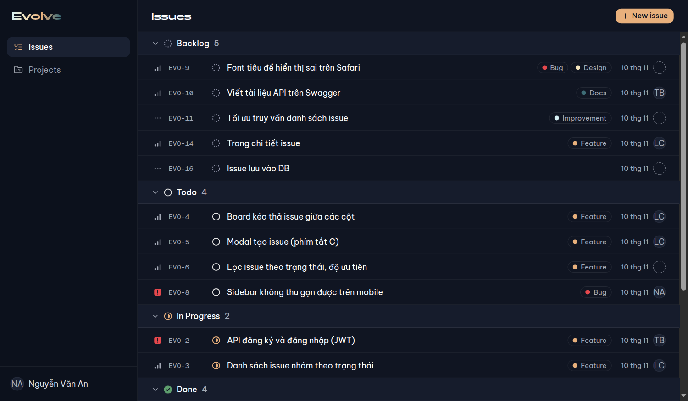
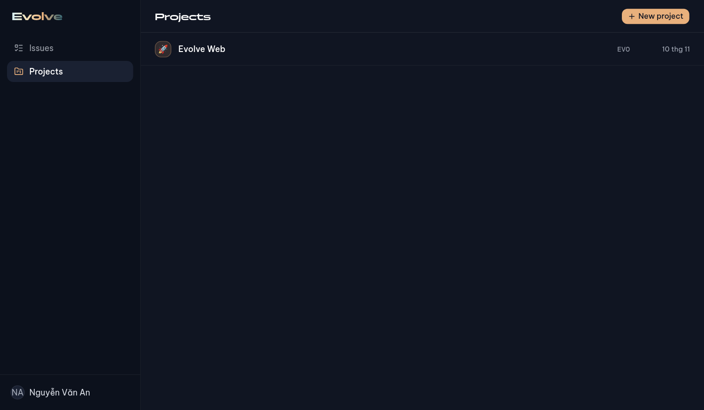
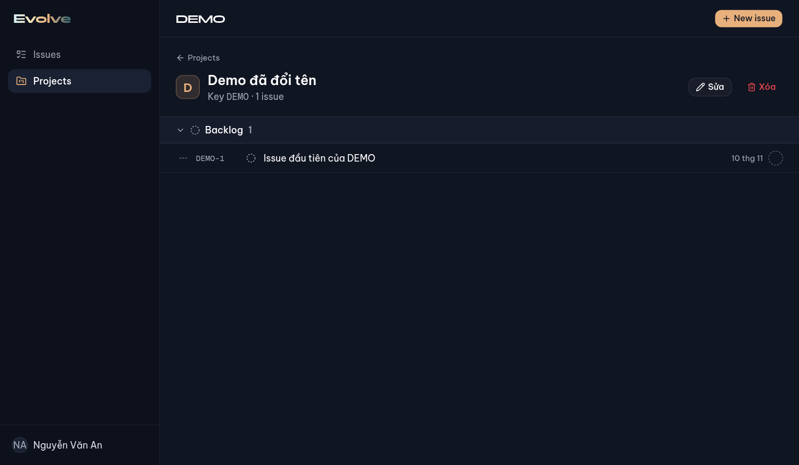
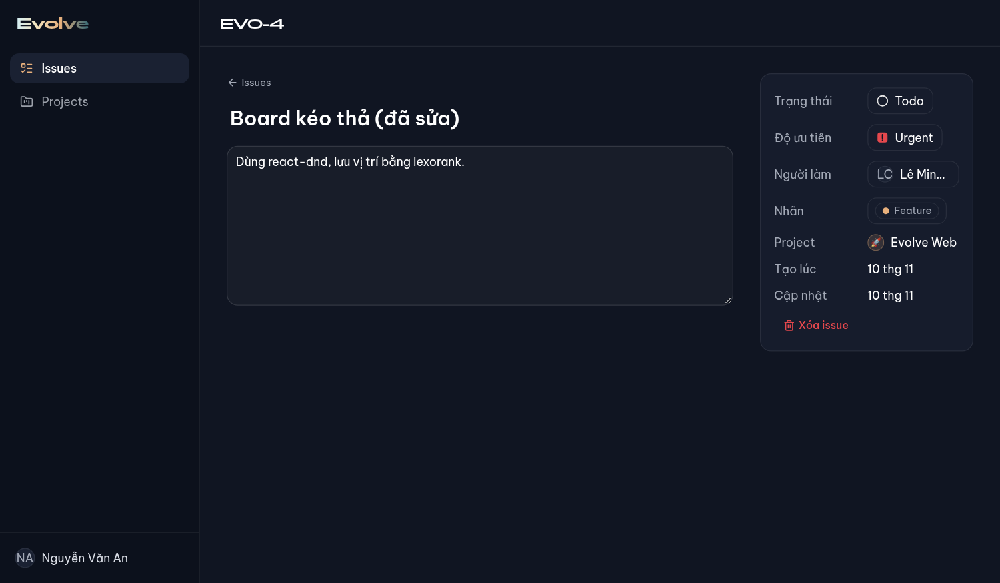
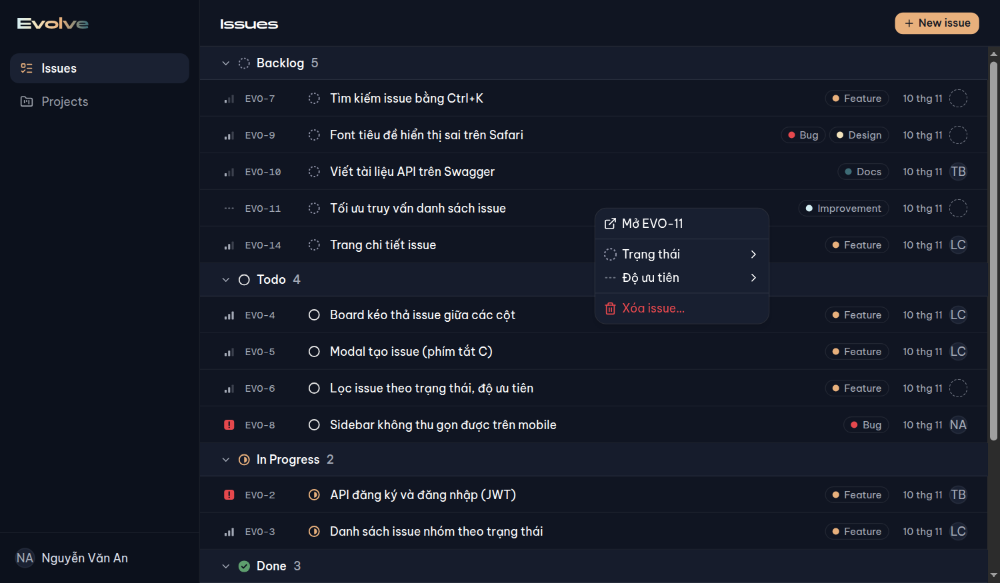
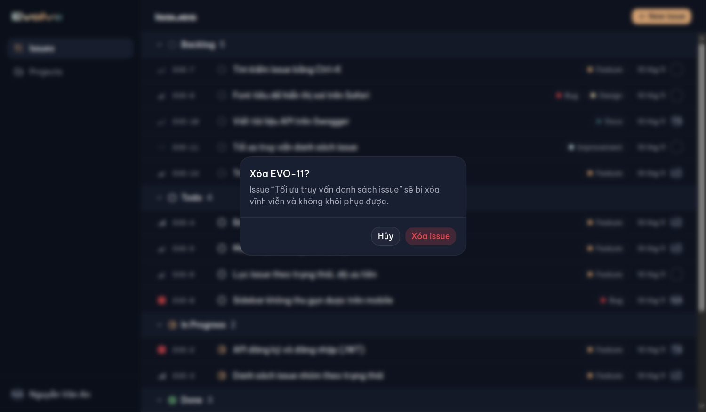
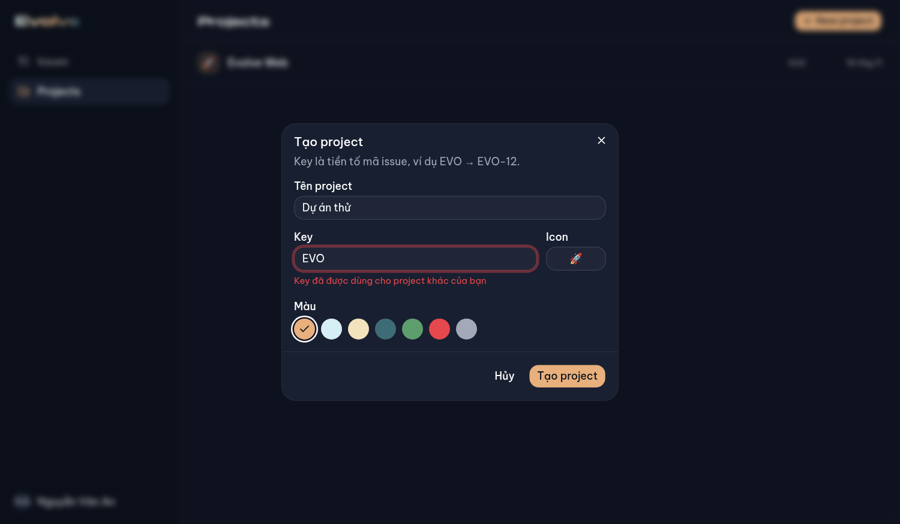

# Báo cáo tuần 4: Evolve Web

> Ngày lập: 10/11/2026 · Người lập: A (nhóm trưởng) · Mốc: **M4**
> Liên quan: [Hướng dẫn](HUONG_DAN.md) · [Nhật ký thực hiện](NHAT_KY.md) · [TIMELINE.md](../TIMELINE.md) · [Báo cáo tuần 3](../W3/README.md)

## 1. Tóm tắt

| Hạng mục | Kết quả |
|---|---|
| Mốc M4 | ✅ **Đạt, đã merge vào `dev`** (`9153543`, CI xanh) |
| Task | 8/8 task code xong (W4-A1–A3, B1–B2, C1–C3); W4-ALL (họp, demo) chưa làm |
| Pull request | 8 PR (#81–#88), mỗi PR tách từ `dev`, CI xanh rồi squash merge (quyền admin, đã được nhóm trưởng cho phép cho tuần 4) |
| Test tự động | **121** (shared 5 · api unit 8 + e2e 36 · web 72); tuần 3 là 74 |
| Kiểm tra trên trình duyệt thật | **52/52 bước** (7 kịch bản, API + web + PostgreSQL thật) |
| Thay đổi | 60 file, +2743 / −212 dòng |
| Người làm | Toàn bộ do **A** làm (kể cả task của B và C), commit đứng tên `dungpcaudio9999` |

**Mốc M4:** "Tạo, sửa, xóa issue và project trên web; dữ liệu lưu DB và vẫn còn khi tải lại trang. Có trang chi tiết issue" → đạt đủ. Từ tuần này **web không còn dùng dữ liệu mẫu**: mọi thứ đọc/ghi qua API.

## 2. Kết quả theo task

| Task | Người được giao | PR | Issue | Kết quả |
|---|---|---|---|---|
| W4-B2 | B | #81 | #72 | `GET /users`, `GET /labels` (cần JWT) |
| W4-B1 | B | #82 | #73 | Module issues: CRUD, lọc, sinh `KEY-số` trong transaction, rank lexorank; 10 e2e |
| W4-A1 | A | #83 | #74 | `projects-store`, trang `/projects`, modal tạo/sửa project |
| W4-C1 | C | #84 | #75 | `issues-store` gọi API (cập nhật ngay, lỗi thì hoàn tác); bỏ dữ liệu mẫu khỏi app |
| W4-C2 | C | #85 | #76 | Menu chuột phải (đổi trạng thái/độ ưu tiên, xóa có xác nhận), chọn nhiều nhãn |
| W4-C3 | C | #86 | #77 | Trang `/issues/[id]`: sửa tiêu đề tại chỗ, mô tả, panel thuộc tính |
| W4-A2 | A | #87 | #78 | Trang `/projects/[id]`: sửa, xóa (cảnh báo xóa cả issue), issue của project |
| W4-A3 | A | #88 | #79 | Cô lập dữ liệu giữa người dùng: xóa store khi đăng nhập/đăng xuất; e2e 2 người dùng |

So với TIMELINE gốc: **W4-B3 (test API auth) đã làm từ tuần 3** nên thay bằng e2e cho issues (trong W4-B1) và e2e cô lập dữ liệu (W4-A3).

| Danh sách project | Chi tiết project | Chi tiết issue |
|---|---|---|
|  |  |  |

## 3. Quyết định (cần cả nhóm biết)

| Vấn đề | Quyết định | Lý do |
|---|---|---|
| Ai thấy issue | Issue thuộc **project của mình**; người khác → 404 | Theo luật "chỉ chủ project" đã chốt ở tuần 3. **Hệ quả:** Bình/Chi **không thấy** issue được giao trong project của An. Muốn đổi (vd. người được giao cũng thấy) là quyết định của nhóm |
| Sinh mã issue | Tăng `Project.issueCounter` **trong transaction** | 5 issue tạo cùng lúc vẫn có mã không trùng, liên tiếp (đã có e2e) |
| Đổi trạng thái | Issue xuống **cuối cột mới** | Đặt vào giữa cột là việc của kéo thả (`PATCH /issues/:id/move`, tuần 5) |
| Đổi project của issue | **Không cho** (`projectId` khi sửa bị bỏ qua) | Mã `EVO-12` gắn với project |
| Số mã sau khi xóa | Không dùng lại | Tránh nhầm với issue đã xóa |
| Sửa/xóa trên web | Cập nhật giao diện **ngay**, API lỗi thì **hoàn tác** | Thao tác mượt; tạo issue thì **chờ API** vì mã và rank do server sinh |
| Đăng xuất / đăng nhập | **Xóa dữ liệu store** của người trước | Người sau không thấy dữ liệu cũ, kể cả thoáng qua |
| Tự đăng xuất | Về `/login` **không** giữ `?next` | Người đăng nhập sau có thể là người khác; phiên hết hạn (401) vẫn giữ `?next` |
| `lib/sample-data.ts` | Giữ, **chỉ dùng cho `/dev/ui` và test** | App lấy dữ liệu thật qua API |

## 4. Lỗi phát hiện và đã sửa trong tuần

| Lỗi | Phát hiện bằng | Sửa ở |
|---|---|---|
| Nhãn "Icon" lệch xuống khi ô Key có dòng lỗi | Ảnh chụp | #83 (`items-start`, đo lại lệch 0px) |
| Modal tạo issue có thể xóa chữ đang gõ khi danh sách project tải xong | Đọc lại code | #84 (chỉ điền ô project nếu còn trống) |
| Menu chuột phải không mở trên dòng issue (`IssueLine` không chuyển `ref`/sự kiện xuống `div`) | Đọc lại code khi gắn menu | #85 |
| Tên người làm dài bị xuống dòng trong nút | Ảnh chụp | #86 (cắt bằng "…") |
| Người đăng nhập sau có thể thấy thoáng qua dữ liệu người trước | Phân tích luồng đăng xuất | #88 (xóa store) |
| Tự đăng xuất vẫn giữ `?next`, người sau bị đưa vào trang của người trước | Kiểm tra trên trình duyệt | #88 (`logoutReason`) |

Ngoài ra có 3 lần **script kiểm tra trình duyệt** báo lỗi giả (do bấm khi hiệu ứng mở modal chưa xong, gõ khi chưa đặt con trỏ vào ô…). Đã xác minh từng lần app không có lỗi rồi sửa script (chi tiết trong [nhật ký](NHAT_KY.md)).

## 5. Kiểm tra đã làm

**Tự động (máy và CI cho mỗi PR):**

| Phần | Test | Mới trong tuần 4 |
|---|---|---|
| api e2e (PostgreSQL thật) | 36 | issues 10 (gồm 5 issue tạo đồng thời), users/labels 3, cô lập dữ liệu 4 |
| web | 72 | store issue gọi API 11 (gồm hoàn tác khi lỗi), projects-store 6, modal project 3, menu chuột phải 2, chọn nhãn 2, tiêu đề sửa tại chỗ 4, chi tiết issue 4, chi tiết project 3, xóa store khi đăng nhập/đăng xuất 2 |
| api unit · shared | 8 · 5 | – |

**Trên trình duyệt thật** (chạy lại toàn bộ trên `dev` cuối tuần), 52/52:

| Kịch bản | Bước | Nội dung chính |
|---|---|---|
| Đăng nhập (tuần 3) | 9 | Chạy lại để chắc không hỏng |
| Projects | 7 | An thấy 1 project; key trùng báo lỗi tại ô; tạo → tải lại vẫn còn; Bình chỉ thấy MOB |
| Issue qua API | 7 | 15 issue từ DB; đổi trạng thái → tải lại vẫn giữ; tạo bằng phím C → tải lại vẫn còn |
| Menu chuột phải + nhãn | 9 | Xóa có xác nhận → tải lại vẫn mất; Esc chỉ đóng popover nhãn; issue 2 nhãn lưu đủ |
| Chi tiết issue | 5 | Sửa tiêu đề, mô tả, độ ưu tiên → tải lại vẫn giữ; Bình mở link issue của An → "Không tìm thấy" |
| Chi tiết project | 8 | Tạo DEMO; New issue chọn sẵn DEMO → DEMO-1; sửa tên (key khóa); xóa có cảnh báo |
| Cô lập dữ liệu | 7 | Đăng xuất → Bình; **lấy mẫu trang liên tục 3 giây: không lúc nào hiện dữ liệu của An** |

| Menu chuột phải | Xác nhận xóa | Key trùng |
|---|---|---|
|  |  |  |

## 6. Giới hạn hiện tại

- **Kéo thả (board)** chưa có: `moveIssue` chỉ đổi trên trình duyệt, API `PATCH /issues/:id/move` là việc tuần 5.
- Bình/Chi không thấy issue được giao trong project của An (xem mục 3).
- Mỗi lần mở danh sách issue/project đều tải lại toàn bộ từ API (chưa có phân trang). Đủ cho quy mô đồ án.
- Script kiểm tra trình duyệt (DevTools Protocol) vẫn chỉ ở máy A, **chưa đưa vào repo**; test E2E chính thức bằng Playwright ở W6.

## 7. Tiến độ và việc còn lại

- Theo lịch (bắt đầu 14/10), hôm nay 10/11 là cuối tuần 4 → **đã bắt kịp lịch** về sản phẩm (M4 đạt đúng tuần).
- Vẫn tồn đọng về làm việc nhóm:

| Việc | Ai |
|---|---|
| **Mời B và C vào repo** (vẫn chỉ có 1 thành viên) | A |
| B, C đọc lại code đã làm thay (api: issues, users, labels; web: store gọi API, menu, trang chi tiết) | B, C |
| Họp và demo M4 (#80); issue tồn đọng: #6, #8, #12, #13 (tuần 1), #35 (tuần 2), #57 (tuần 3) | Cả nhóm |
| Xác nhận quyết định ở mục 3, nhất là "ai thấy issue" | Cả nhóm |
| Release `dev → main` (v0.4) | A |

## 8. Chuẩn bị cho tuần 5 (board, filter, deploy)

- **B:** `PATCH /issues/:id/move` (đổi trạng thái + rank lexorank theo `afterId`/`beforeId`, schema `moveIssueSchema` có sẵn), test; deploy API lên Render, DB lên Neon.
- **C:** board kéo thả (react-dnd) dùng `moveIssue` của store (đã có logic tính rank, chỉ cần gọi API); filter bar; tìm kiếm Ctrl+K (API đã hỗ trợ `q`).
- **A:** deploy web lên Vercel, biến môi trường, CORS; README.
