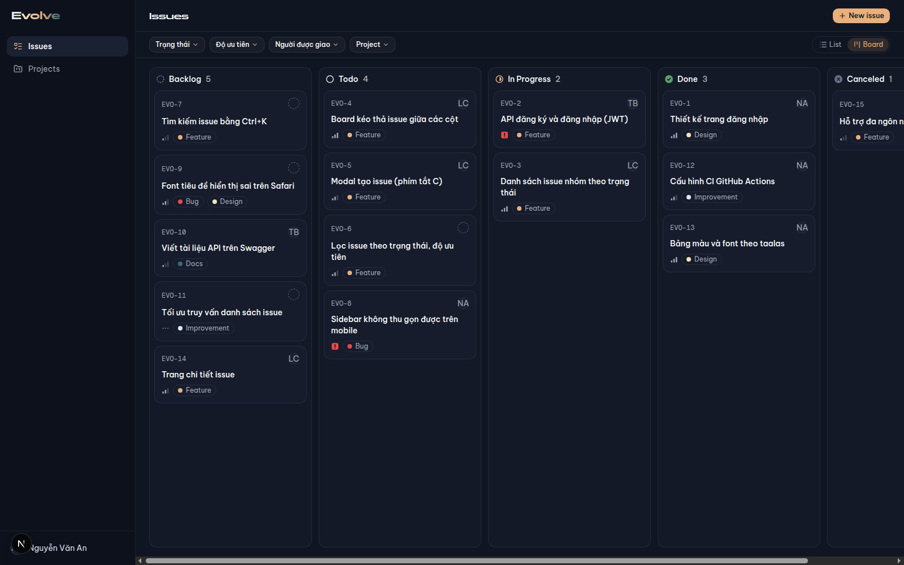
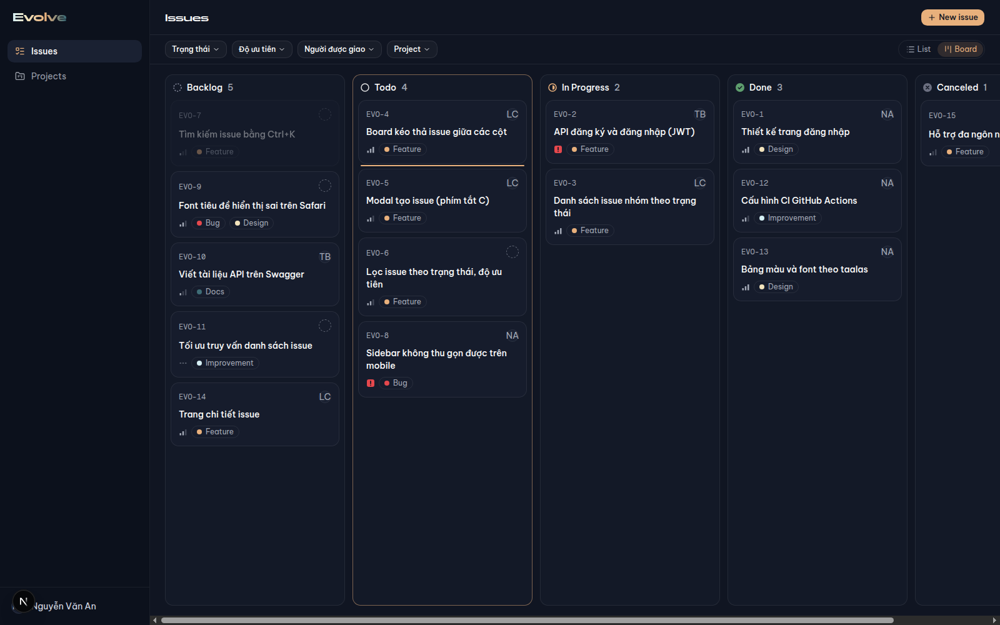
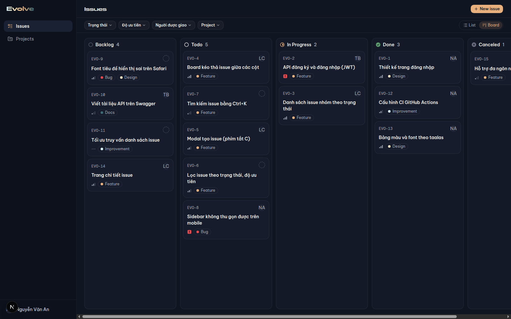
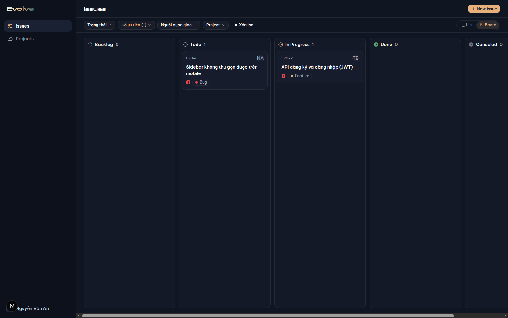

# Báo cáo tuần 5: Evolve Web

> Ngày lập: 26/11/2026 · Người lập: A (nhóm trưởng) · Mốc: **M5** (đủ MVP)
> Liên quan: [TIMELINE.md](../TIMELINE.md) · [Báo cáo tuần 4](../W4/README.md)

## 1. Tóm tắt

| Hạng mục | Kết quả |
|---|---|
| Mốc M5 | ⚠️ **Đạt một phần.** Phần code đã xong: board kéo thả lưu vào DB, filter, tìm kiếm. **Chưa deploy**, nên chưa có link online |
| Task | 6/9 task code xong (W5-A3, B1, B2, C1, C2, C3). Chưa làm: W5-A1, A2, B3 (deploy), W5-ALL (họp, demo) |
| Pull request | [#91](https://github.com/dungpcaudio9999/evolve_web/pull/91) từ `feature/w5` vào `dev`, CI xanh. **Đã squash merge** (`8b01cc4`) bằng **quyền admin, bỏ qua review bắt buộc**, theo quyết định của nhóm trưởng ngày 26/11 |
| Test tự động | **132** (shared 5 · api unit 8 + e2e 40 · web 79); tuần 4 là 121 |
| Kiểm tra trên trình duyệt thật | **11/11 bước** kéo thả và lọc trên Chrome (API, web và PostgreSQL thật) |
| Người làm | Toàn bộ do A làm (kể cả task của B và C), có Claude Code hỗ trợ |

## 2. Kết quả theo task

| Task | Người được giao | Kết quả |
|---|---|---|
| W5-B1 | B | `PATCH /issues/:id/move` nhận `{ status, afterId?, beforeId? }`. Rank lexorank được tính giữa hai issue lân cận; không có lân cận thì xuống cuối cột |
| W5-B2 | B | 4 e2e trong `apps/api/test/issues-move.e2e-spec.ts`: đặt giữa/đầu cột, sang cột khác, dữ liệu sai → 400, issue của người khác → 404 |
| W5-C1 | C | `issue-board.tsx`: 5 cột, thẻ có mã, tiêu đề, độ ưu tiên, nhãn, người làm; chuột phải dùng lại menu của list |
| W5-C2 | C | `moveIssue` trong store cập nhật giao diện ngay rồi gọi API; lỗi thì trả về chỗ cũ. Cách tính vị trí thả nằm ở `lib/board-drop.ts` |
| W5-A3 | A | `filter-bar.tsx` + `issues-view.tsx`: lọc theo trạng thái, độ ưu tiên, người được giao (kể cả "Chưa giao"), project; chọn được nhiều giá trị; nút List/Board. Tất cả lưu trên URL, ví dụ `/issues?status=TODO,DONE&view=board` |
| W5-C3 | C | `search-command.tsx`: Ctrl+K / ⌘K mở ô tìm theo tiêu đề hoặc mã, Enter mở trang chi tiết. Gắn trong layout nên dùng được ở mọi trang |
| W5-A1, A2, B3 | A, B | **Chưa làm** (xem mục 6) |

## 3. Quyết định (cần cả nhóm biết)

| Vấn đề | Quyết định | Lý do |
|---|---|---|
| Thư viện kéo thả | **HTML5 Drag and Drop** có sẵn, **không** dùng react-dnd | Không thêm được thư viện trên laptop (mạng chặn npm). Board chỉ cần kéo giữa các cột nên API có sẵn là đủ. **Hạn chế:** HTML5 DnD không hỗ trợ cảm ứng, nên trên điện thoại chưa kéo được |
| Lưu bộ lọc trên URL | `useSearchParams` của Next.js, **không** dùng nuqs | Cùng lý do; cần ít mã hơn |
| Lọc ở đâu | **Trên trình duyệt**, trên danh sách đã tải | Danh sách nhỏ, đổi bộ lọc không phải chờ API. API vẫn hỗ trợ lọc nếu sau này cần phân trang |
| Quy tắc lọc | Trong một tiêu chí là "hoặc", giữa các tiêu chí là "và" | Giống Linear |
| Issue lân cận khi `/move` | Phải cùng cột đích và đúng thứ tự, nếu không thì 400 | Tránh rank sai khi giao diện bị cũ |
| Cột, thẻ board | Gộp chung trong `issue-board.tsx` | TIMELINE dự kiến 3 file; gộp lại cho dễ đọc vì mỗi phần chỉ vài chục dòng |
| Board ở `/projects/[id]` | Chưa có, trang này vẫn chỉ có list | Để sau, `IssuesView` nhận sẵn `projectId` |

## 4. Kiểm tra đã làm

Chạy trên máy A520M: cài sạch bằng `pnpm install` với PostgreSQL 16 trong Docker, giống CI.

| Phần | Kết quả | Mới trong tuần 5 |
|---|---|---|
| typecheck (shared, api, web), lint | Không lỗi | – |
| api e2e (PostgreSQL thật) | 40/40 | `/move` 4 |
| api unit | 8/8 | – |
| web | 79/79 | lọc 3, vị trí thả 2, `moveIssue` gọi API và về chỗ cũ khi lỗi 2 (thay 1 test cũ), Ctrl+K 1 |

Trên laptop ThinkPad, test web chạy lại cũng qua 79/79, sau khi sửa `node_modules` (xem mục 5).

**Trên trình duyệt thật**, 11/11. Chrome được điều khiển qua DevTools Protocol, kéo bằng thao tác chuột thật (nhấn, rê, thả), không gọi thẳng hàm trong code. Dữ liệu là bản seed, đăng nhập bằng An:

| Bước | Kết quả |
|---|---|
| Board có đủ 5 cột | Qua |
| Kéo EVO-7 từ Backlog vào giữa thẻ 1 và 2 của Todo: giao diện đúng, DB đúng (`EVO-4 EVO-7 EVO-5 …`), đã rời Backlog | Qua (3 bước) |
| Tải lại trang, vị trí giữ nguyên | Qua |
| Cùng cột: kéo thẻ cuối lên đầu | Qua |
| Thả vào khoảng trống cột Done, issue nằm cuối cột | Qua |
| Thả lại chỗ cũ, thứ tự không đổi | Qua |
| Bấm vào thẻ (không kéo) mở trang chi tiết | Qua |
| `?view=board&priority=URGENT`: 2 thẻ, khớp API | Qua |
| Không có lỗi JavaScript trên trang | Qua |

Lần chạy đầu có 1 bước báo lỗi giả, do script trả về phần tử DOM thay vì true/false. Đã sửa script, seed lại và chạy lại toàn bộ.
Chưa thử trên trình duyệt: Ctrl+K (đã có unit test) và kéo thả trên màn hình cảm ứng.

| Board | Đang kéo (thẻ mờ, vạch cam chỉ chỗ thả) |
|---|---|
|  |  |

| Sau khi tải lại (EVO-7 ở vị trí 2 của Todo) | Lọc Urgent |
|---|---|
|  |  |

## 5. Sự cố môi trường

| Vấn đề | Cách xử lý |
|---|---|
| Laptop chặn `registry.npmjs.org` và Docker Hub, nên không cài được thư viện và không có PostgreSQL | Chạy test đầy đủ trên máy A520M. Không thêm thư viện mới (mục 3) |
| Laptop dùng Node < 14 | Đã cài Node 22 bằng nvm |
| `node_modules` trên laptop hỏng: symlink của pnpm không đúng, typecheck web báo 53 lỗi trong code cũ | Script `~/fix-pnpm-links.mjs` dựng lại symlink bằng **đường dẫn tương đối** (chạy offline; mặc định chỉ xem, `--apply` để sửa). Sau đó test web qua 79/79 |
| Mạng đi internet qua proxy `proxy.fpt.vn`; **Turbopack không đi qua proxy được**, không tải được Google Fonts nên mọi trang báo lỗi 500 | Chạy web bằng `next dev` (webpack), không dùng `pnpm dev`. Node 22 cần `NODE_USE_ENV_PROXY=1` để dùng biến `HTTPS_PROXY` |
| Ổ SFTP (gvfs) không tạo được symlink | Không chạy `pnpm install` và test qua ổ mạng; chạy trực tiếp trên laptop hoặc trên bản clone ở A520M |

## 6. Việc còn lại

| Việc | Ai | Ghi chú |
|---|---|---|
| Thử Ctrl+K trên trình duyệt thật; xem board trên điện thoại | A | Kéo thả và lọc đã thử (mục 4) |
| Sửa script `dev` của web cho chạy được sau proxy (bỏ `--turbopack` hoặc tự host font) | A | Hiện phải chạy `next dev` bằng tay |
| B, C đọc lại PR #91 (đã merge không qua review) | B, C | Góp ý thì mở issue hoặc PR mới |
| W5-A1, B3: tạo Neon DB, migrate, seed; deploy API lên Render | A, B | Cần tài khoản; làm từ máy có mạng |
| W5-A2: deploy web lên Vercel, `NEXT_PUBLIC_API_URL`, `CORS_ORIGIN` | A | Sau W5-A1 |
| Họp và demo M5 trên link online (W5-ALL) | Cả nhóm | Sau khi deploy |
| Tồn đọng từ tuần 4: mời B, C vào repo; B, C đọc lại code đã làm thay | A, B, C | |

## 7. Chuẩn bị cho tuần 6

- Test E2E bằng Playwright cho luồng đăng nhập → tạo issue → kéo thả (W6-A1). Playwright có hỗ trợ HTML5 DnD qua `dragTo`; các bước ở mục 4 dùng làm kịch bản được.
- `empty-state` cho board và projects (W6-C1); xem lại board trên điện thoại vì HTML5 DnD không chạy trên màn hình cảm ứng.
- `docs/api/`, `docs/database/` (W6-B2).
